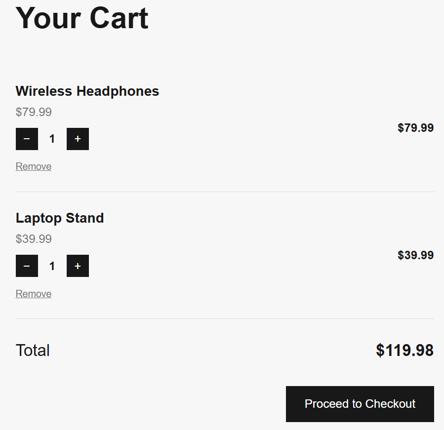

# NOVA. E-Commerce Store

NOVA. is a modern e-commerce web application built with Django as part of my Full Stack Development Internship at CodeAlpha.

The application provides a complete and user-friendly shopping experience, from browsing products to placing an order.

## Features

- Modern product catalog with images, prices, and descriptions
- Detailed product pages
- Product stock availability
- User registration
- User login and logout
- Session-based shopping cart
- Add products to cart
- Increase and decrease product quantities
- Remove products from cart
- Dynamic cart counter
- Stock validation
- Out-of-stock handling
- Checkout system
- Order creation and persistent order storage
- Automatic stock update after a successful order
- Order confirmation page
- Django Admin dashboard for managing products and orders
- Responsive and modern user interface

## Technologies Used

- Python
- Django
- HTML5
- CSS3
- SQLite
- Git
- GitHub

## Project Structure

```text
CodeAlpha_Ecommerce/
│
├── ecommerce/
│   ├── settings.py
│   ├── urls.py
│   └── ...
│
├── store/
│   ├── migrations/
│   ├── static/
│   │   └── store/
│   │       ├── images/
│   │       └── style.css
│   │
│   ├── templates/
│   │   └── store/
│   │       ├── home.html
│   │       ├── product_detail.html
│   │       ├── cart.html
│   │       ├── checkout.html
│   │       ├── login.html
│   │       ├── register.html
│   │       └── order_success.html
│   │
│   ├── admin.py
│   ├── models.py
│   ├── urls.py
│   └── views.py
│
├── manage.py
├── requirements.txt
├── .gitignore
└── README.md
```

## Main Workflow

The main shopping workflow is:

**Browse Products → Product Details → Add to Cart → Login/Register → Checkout → Place Order → Order Confirmation**
## Screenshots

### Home Page


### Product Collection


### Product Details


### Shopping Cart



### Order Confirmation


## Installation

### 1. Clone the repository

```bash
git clone <repository-url>
cd CodeAlpha_Ecommerce
```

### 2. Create a virtual environment

```bash
python -m venv venv
```

### 3. Activate the virtual environment

On Windows:

```bash
venv\Scripts\activate
```

On macOS/Linux:

```bash
source venv/bin/activate
```

### 4. Install the dependencies

```bash
pip install -r requirements.txt
```

### 5. Apply database migrations

```bash
python manage.py migrate
```

### 6. Run the development server

```bash
python manage.py runserver
```

### 7. Open the application

Open the following address in your browser:

```text
http://127.0.0.1:8000/
```

## Key Functionalities

### Product Management

Products contain information such as name, description, price, image, and available stock. Products can be managed through the Django Admin dashboard.

### Shopping Cart

The application uses Django sessions to manage the shopping cart. Users can add products, change quantities, remove products, and see the total price of their cart.

### Stock Management

The application checks product availability before allowing additional quantities to be added. Out-of-stock products cannot be added to the cart.

When an order is successfully placed, the purchased quantities are automatically deducted from the available stock.

### Authentication

Users can create an account, log in, and log out. Authentication is required before completing the checkout process.

### Order Processing

During checkout, the application validates the cart and available stock before creating the order.

Orders and their corresponding items are stored in the database, and the cart is cleared after a successful purchase.

Database transactions are used during order processing to help maintain data consistency.

### Admin Dashboard

Django Admin provides an interface for managing:

- Products
- Product stock
- Orders
- Order items
- Users

## Responsive Design

NOVA. includes a responsive interface designed to provide a clean shopping experience across desktop and smaller screens.

## Internship

This project was developed as part of the **CodeAlpha Full Stack Development Internship**.

## Author

**Aline Charafeddine**